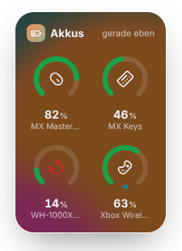
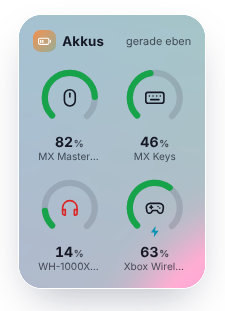
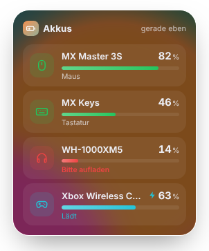
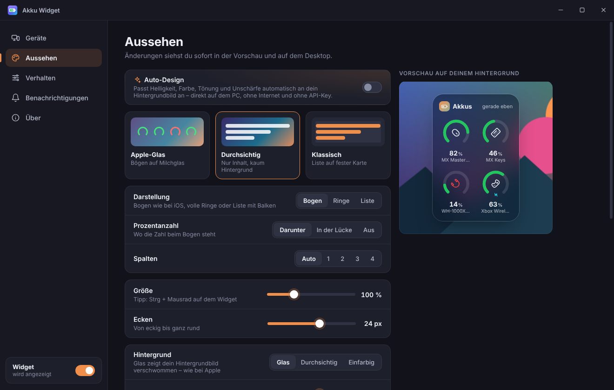

# 🔋 Akku Widget

Ein Desktop-Widget, das dir **immer** zeigt, wie voll die Akkus von **Maus, Tastatur, Headset, Controller & Co.** sind – wie die Akku-Widgets am iPhone oder Mac. Auch für Mäuse und Tastaturen mit **eigenem USB-Empfänger** (2,4 GHz), nicht nur für Bluetooth.

<p>
  
  
  
</p>



## Herunterladen & starten

1. Unter **[Releases](https://github.com/anonym239/Akku/releases/latest)** die Datei `Akku-Widget-…-win-x64.exe` herunterladen.
2. Doppelklick – die App installiert sich mit einem Klick und startet sofort.
3. Beim Start öffnen sich die Einstellungen, das Widget erscheint oben rechts auf dem Desktop.

> Ohne Installation geht es mit `Akku-Widget-…-portable.exe`.
> Windows SmartScreen meldet unbekannte Programme manchmal mit „Der Computer wurde durch Windows geschützt“ → **Weitere Informationen → Trotzdem ausführen**.

## Funktionen

- **Bogen wie bei iOS:** Der Akku läuft als Bogen von unten links im Uhrzeigersinn bis unten rechts (270°), das Geräte-Icon steht in der Mitte. Die Prozentzahl steht wahlweise **darunter**, **in der Lücke** oder gar nicht.
- **Glas wie bei Apple:** Das Widget zeigt dein Hintergrundbild verschwommen hinter sich und passt so zum Desktop. Unschärfe und Tönung sind einstellbar, außerdem gibt es die Stile *Durchsichtig* und *Einfarbig*.
- **Auto-Design:** Analysiert den Bildausschnitt hinter dem Widget und wählt Hell/Dunkel, Akzentfarbe, Tönung und Unschärfe passend. Wechselst du das Hintergrundbild oder verschiebst das Widget, passt es sich neu an. Das läuft **komplett auf deinem PC – ohne Internet und ohne API-Key**. Sobald du selbst etwas an Farbe oder Tönung änderst, schaltet es sich aus.
- **Alles selbst einstellbar:** Größe (60–200 %, auch per **Strg + Mausrad** auf dem Widget), Breite, Ecken, Spalten, Kopfzeile, Prozent, Namen. Dazu die Vorlagen *Apple-Glas*, *Durchsichtig* und *Klassisch*.
- **Warnung bei niedrigem Akku** als Windows-Benachrichtigung, mit einstellbarer Schwelle und Testknopf
- **Startet mit Windows** – beim Autostart erscheint nur das Widget
- Geräte **umbenennen** oder **ausblenden**, Symbol im Infobereich, Rechtsklick-Menü am Widget, **Demo-Modus**

## Welche Geräte werden erkannt?

| Verbindung | Unterstützt |
|------------|-------------|
| **USB-Empfänger (2,4 GHz)** | **Logitech** Unifying, Bolt und Lightspeed (z. B. MX Master, MX Keys, G305, G Pro, G502 X), auch per USB-Kabel · **Razer** HyperSpeed/kabellos (z. B. Viper, DeathAdder, Basilisk) |
| Bluetooth | Alles, was Windows unter *Einstellungen › Bluetooth & Geräte* mit Akkustand anzeigt |
| Laptop | Eigener Akku des PCs |

Unter **Geräte › USB-Empfänger & Funkgeräte** zeigt die App, welche Empfänger sie gefunden hat und ob sich der Akku lesen lässt.

**Andere Marken** (z. B. SteelSeries, Corsair, HyperX oder günstige No-Name-Empfänger) erkennt die App, sie zeigt deren Akku aber noch nicht an. Jeder Hersteller nutzt ein eigenes, meist geheimes Protokoll. Steht dein Empfänger dort als „Akku nicht lesbar“, schreib Marke, Modell und die angezeigte ID in ein Issue, dann kann Unterstützung ergänzt werden.

## Für Entwickler

```bash
npm install
npm start          # App starten
npm run demo       # mit Beispielgeräten starten
npm test           # Unit-Tests (Bluetooth, USB-Empfänger, Auto-Design, Einstellungen)
npm run test:ui    # klickt alles durch, prüft Stil und Bedienung, macht Screenshots
npm run dist:win   # Windows-Installer bauen
```

Bei jedem Push baut GitHub Actions die Programme für Windows, Linux und macOS automatisch, testet sie (auch auf Windows) und veröffentlicht sie unter *Releases*.

```
src/main/               Hauptprozess: Fenster, Infobereich, Einstellungen, Autostart
src/main/battery/       Akkustand: Bluetooth/System je Betriebssystem
src/main/battery/hid/   USB-Empfänger: Logitech HID++ 2.0, Razer
src/main/autodesign.js  Auto-Design (lokale Bildanalyse)
src/main/wallpaper.js   Hintergrundbild für den Glas-Effekt
src/renderer/           Widget und Einstellungsfenster
```

## Lizenz

MIT
