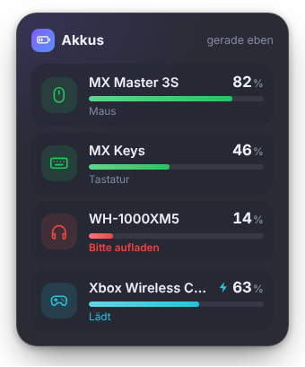
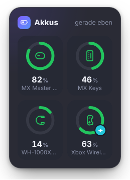
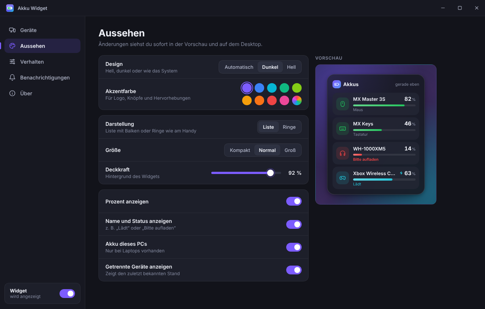

# 🔋 Akku Widget

Ein schlankes Desktop-Widget, das dir **immer** zeigt, wie voll die Akkus von **Maus, Tastatur, Headset, Controller & Co.** sind – so wie die Akku-Widgets am Handy. Kein Programm mehr öffnen, kein Suchen in den Windows-Einstellungen.

<p>
  
  
</p>



## Herunterladen & starten

1. Unter **[Releases](https://github.com/anonym239/Akku/releases/latest)** die Datei `Akku-Widget-…-win-x64.exe` herunterladen.
2. Doppelklick – die App installiert sich mit einem Klick und startet sofort.
3. Beim Start öffnen sich die Einstellungen, das Widget erscheint oben rechts auf dem Desktop.

> Ohne Installation geht es mit `Akku-Widget-…-portable.exe`.
> Windows SmartScreen meldet unbekannte Programme manchmal mit „Der Computer wurde durch Windows geschützt“ → **Weitere Informationen → Trotzdem ausführen**.

## Funktionen

- **Widget auf dem Desktop** – rahmenlos und halbtransparent; einfach mit der Maus hinziehen, wo es stehen soll
- **Zwei Ansichten:** Liste mit Balken oder Ringe wie am Handy, in drei Größen
- **Farben:** Rot, Gelb und Grün zeigen auf einen Blick, wann geladen werden muss; ein Blitz zeigt an, dass das Gerät gerade lädt
- **Warnung**, sobald ein Gerät unter die eingestellte Schwelle fällt (Standard: 20 %)
- **Startet mit Windows** – beim Autostart erscheint nur das Widget, die Einstellungen bleiben zu
- **Einstellungen:** Hell/Dunkel/System, Akzentfarbe, Deckkraft, immer im Vordergrund, Position sperren, Aktualisierungsintervall
- **Geräte umbenennen oder ausblenden**
- Symbol im Infobereich (Taskleiste): Klick öffnet die Einstellungen, Rechtsklick zeigt ein Menü
- **Demo-Modus** zum Ausprobieren ohne passende Geräte

Rechtsklick auf das Widget öffnet ein Menü: Aktualisieren, Einstellungen, Position sperren, Ausblenden und Beenden.

## Welche Geräte werden erkannt?

| System  | Quelle | Geräte |
|---------|--------|--------|
| Windows | Bluetooth-Akkustand, den auch *Einstellungen › Bluetooth & Geräte* anzeigt (über PowerShell, ohne Zusatzsoftware) | Bluetooth- und Bluetooth-LE-Mäuse, -Tastaturen, -Headsets und -Controller; Laptop-Akku |
| Linux   | UPower | Bluetooth und viele Funkgeräte, z. B. Logitech Unifying/Bolt |
| macOS   | ioreg / pmset | Apple- und Bluetooth-Geräte; MacBook-Akku |

**Wichtig unter Windows:** Geräte mit eigenem USB-Empfänger (z. B. Logitech Bolt/Unifying, Razer HyperSpeed, Corsair Slipstream) melden ihren Akkustand an Windows meistens **nicht**, sondern nur an die Hersteller-App. Solche Geräte erscheinen nur, wenn sie zusätzlich per Bluetooth verbunden sind.

## Für Entwickler

```bash
npm install
npm start          # App starten
npm run demo       # mit Beispielgeräten starten
npm test           # Unit-Tests (Auslesen, Einstellungen)
npm run test:ui    # klickt alle Seiten durch, prüft Stil und Bedienung, macht Screenshots
npm run dist:win   # Windows-Installer bauen
```

Bei jedem Push baut GitHub Actions die Programme für Windows, Linux und macOS automatisch, testet sie und veröffentlicht sie unter *Releases*.

Aufbau:

```
src/main/           Hauptprozess: Fenster, Infobereich, Einstellungen, Autostart
src/main/battery/   Auslesen des Akkustands je Betriebssystem
src/renderer/       Widget und Einstellungsfenster (HTML/CSS/JS)
build/              App-Icon (SVG, PNG, ICO)
```

## Lizenz

MIT
